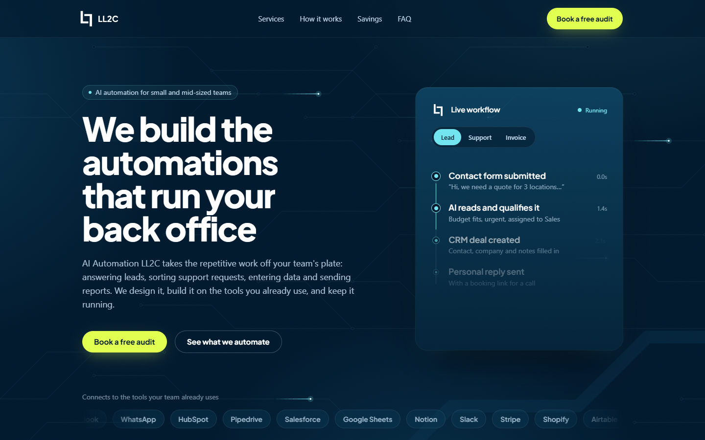

<p align="center">
  <picture>
    <source media="(prefers-color-scheme: dark)" srcset="assets/Logo-complete.svg">
    
  </picture>
</p>

<p align="center">
  
</p>

<h1 align="center">AI Automation LL2C</h1>

<p align="center">Single-page landing site for an AI automation service aimed at small and mid-sized teams.</p>

<p align="center">
  
  
  
  
</p>

## About

A static marketing page for LL2C, a service that builds AI automations for back-office work: lead handling, support requests, data entry and reporting. Everything lives in one `index.html` with no build step.

<!-- TODO: add the live demo URL once deployed -->

## Features

- Hero with an animated "live workflow" panel (Lead, Support, Invoice tabs)
- Interactive circuit-style canvas background that follows the pointer
- Sections: services, process, before/after example, FAQ, contact
- Savings calculator with sliders for team size, hours per week and hourly rate
- Scroll-reveal animations, with `prefers-reduced-motion` support
- Responsive layout, mobile first

## Tech Stack

- HTML + vanilla JavaScript (inline)
- Tailwind CSS via CDN
- Plus Jakarta Sans (Google Fonts)
- Node.js static server for local development (`serve.mjs`)

## Getting Started

### Prerequisites

- Node.js (any recent version with ES modules support)

### Installation

```bash
git clone https://github.com/LucasLima0202/ll2c-ai-automation-landing.git
cd ll2c-ai-automation-landing
```

No dependencies to install.

## Usage

```bash
node serve.mjs
```

Opens the site at `http://localhost:3000`.

Optional: capture full-page screenshots into `temporary screenshots/` (requires Puppeteer; set its path in `screenshot.mjs`):

```bash
node screenshot.mjs http://localhost:3000 [label]
```

## Project Structure

```
.
├── assets/          # README logo and cover
├── brand_assets/    # Logo, favicon and brand guideline
├── index.html       # The landing page
├── serve.mjs        # Local static server (port 3000)
└── screenshot.mjs   # Puppeteer screenshot helper
```

## Author

**LL2C**: [@LucasLima0202](https://github.com/LucasLima0202)

<!-- TODO: add a LICENSE file -->
